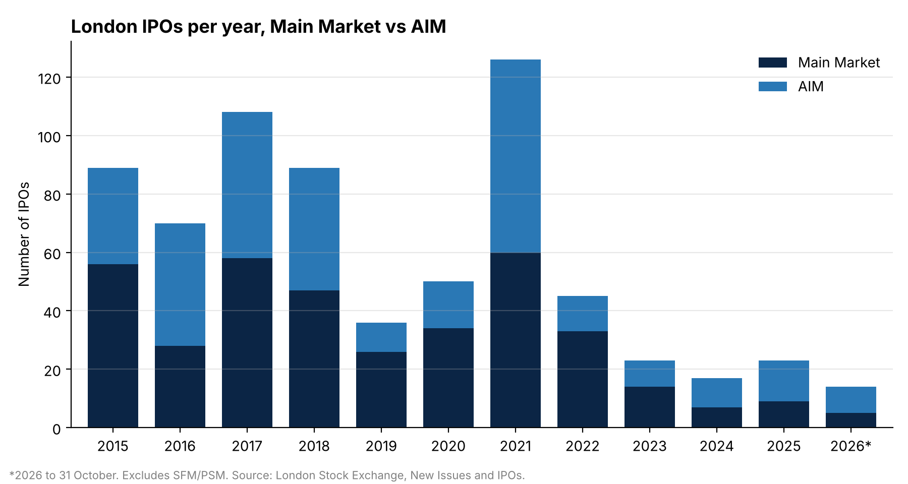
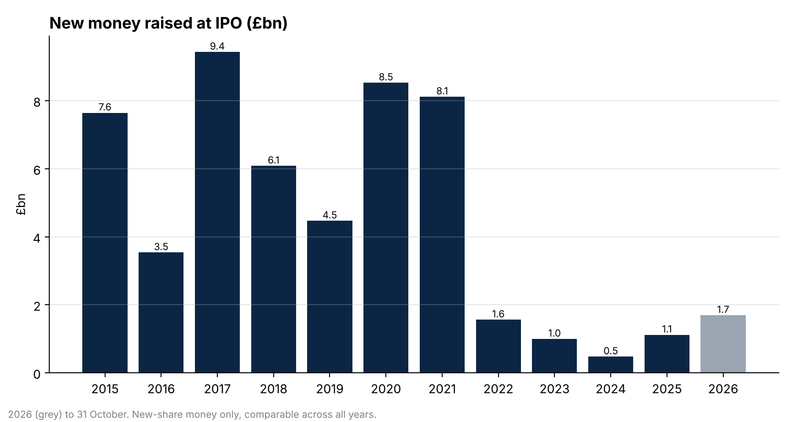
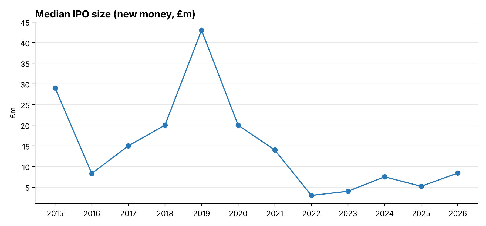

# London's IPO Drought: UK New Listings 2015–2026

An analysis of every IPO on the London Stock Exchange since 2015, built with **SQL (SQLite)** and **Python (pandas, matplotlib)** on the LSE's own *New Issues and IPOs* dataset (6,295 admissions, 1995 to 31 October 2026).

**Question:** How far has London's IPO market fallen since 2021, where has it fallen most, and is there any sign of recovery?



## Key findings

1. **Activity has fallen by about two-thirds.** London averaged **82 IPOs a year from 2015 to 2021**, but only **27 a year from 2022 to 2025**. 2024 was the low point, with **17 IPOs**, down 87% from the 2021 peak of 126.
2. **Money raised has fallen even further.** New money raised at IPO averaged **£6.8bn a year from 2015 to 2021**, compared with **£1.0bn from 2022 to 2025** (−85%). In 2024 it was just **£477m**, and only one IPO raised more than £100m.
3. **Deals have become much smaller.** The median IPO raised about **£20m** in 2015–2021, but only about **£5m** in 2022–2025. Large flotations, which fund most of the market's capital raising, have mostly stopped.
4. **AIM has been hit hardest.** AIM went from **66 IPOs (£1.5bn)** in 2021 to **9 IPOs (£46m)** in 2023.
5. **2026's apparent recovery depends on one deal.** New money for 2026 so far is **£1.7bn**, the highest since 2021. But **85%** of it comes from a single IPO, the National Investment Fund of the Republic of Uzbekistan (£1.4bn). Without it, the other 13 IPOs raised only **£258m**.
6. **More companies are moving from AIM to the Main Market.** There were **7 transfers in 2025 and 8 in 2026 so far**, the highest in the period (the previous high was 6, in 2015 and 2016). This happened after the FCA replaced the premium and standard listing segments with a single listing category in July 2024 ([FCA PS24/6](https://www.fca.org.uk/publications/policy-statements/ps24-6-primary-markets-effectiveness-review-feedback-cp23-31-final-uk-listing-rules)). The data shows the two happened at the same time, not that one caused the other.




## So what?
Headline fundraising figures for London are now driven by a handful of mostly international deals. That makes year-on-year totals volatile and easy to misread. The more telling measures are the **count** of IPOs and the **median deal size**, and neither has recovered yet. The rise in AIM-to-Main-Market transfers is the clearest early sign that the 2024 listing reforms are changing behaviour. It's worth watching whether these transfers turn into new IPOs over the next few years.

## Method
| Step | File |
|---|---|
| Clean the LSE workbook (header row, '-' placeholders, types) and load it into SQLite | `src/build_db.py` |
| IPOs and new money by year, AIM vs Main Market | `sql/01_ipos_by_year_and_market.sql` |
| Annual totals, average size, number of £100m+ deals | `sql/02_annual_totals.sql` |
| Transfers between markets | `sql/03_aim_to_main_transfers.sql` |
| Top sectors since 2021 | `sql/04_top_sectors.sql` |
| Data-quality checks | `sql/05_data_quality.sql` |
| Share of each year's money raised by its largest IPO (window functions) | `sql/06_deal_concentration.sql` |
| Run all queries, compute medians, draw charts | `src/analysis.py` |

All query results are saved as CSVs in `outputs/`.

## Data-quality notes
- **New-share money** is used as the main measure because it is recorded consistently for every year. Money from sales of existing shares is only recorded from 15 June 2016, so totals including it can't be compared before 2017.
- **2026 records look less reliable.** Six 2026 IPOs have identical non-zero "new" and "existing" amounts (compared with at most one per year before), and seven have no country of incorporation. The LSE notes that it changed its issue-type naming in August 2026. Treat 2026 as provisional.
- "IPO" follows the LSE definition: a first admission that raises capital. Introductions, reverse takeovers and transfers are excluded.
- Market groups: Main Market = UK + International Main Market. The Specialist Fund Segment and Professional Securities Market (7 IPOs in 2015, none since) appear in the totals but not in the market chart.

## How to run
```bash
pip install -r requirements.txt
# 1. Download "New Issues and IPO Summary" from lseg.com > Investor Relations > Trading Statistics
#    and save it as data/New_issues_and_IPOs.xlsx
python src/build_db.py data/New_issues_and_IPOs.xlsx data/lse_new_issues.db
python src/analysis.py data/lse_new_issues.db outputs
```

## Source
London Stock Exchange, *New Issues and IPO Summary* (data to 31 October 2026), from [LSEG Trading Statistics](https://www.lseg.com/en/investor-relations/trading-statistics). The raw workbook is not included in this repo. Download it from the link above.
